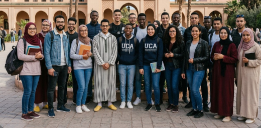
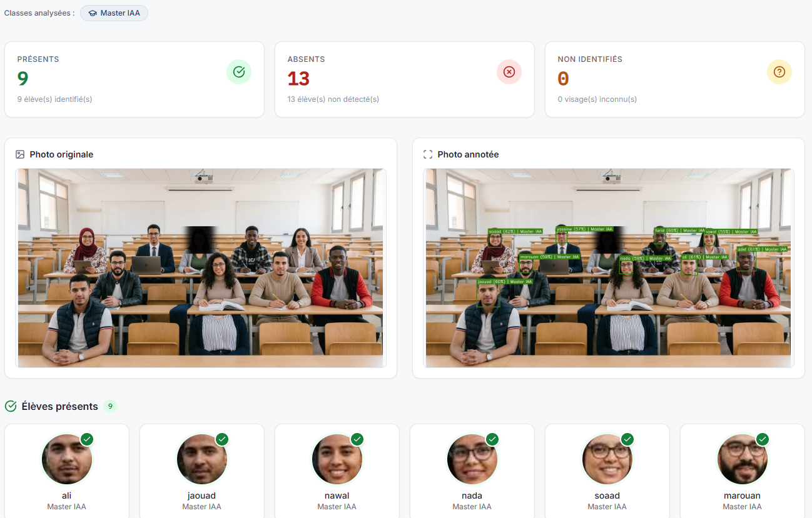
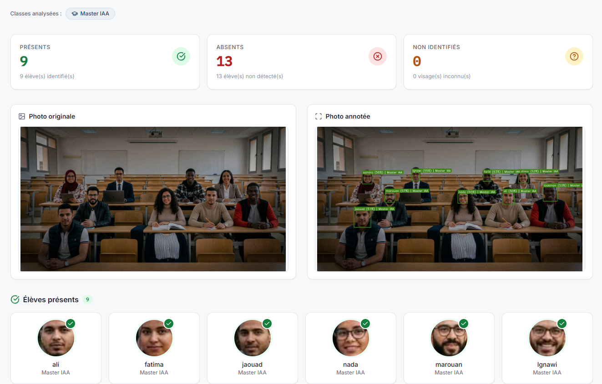
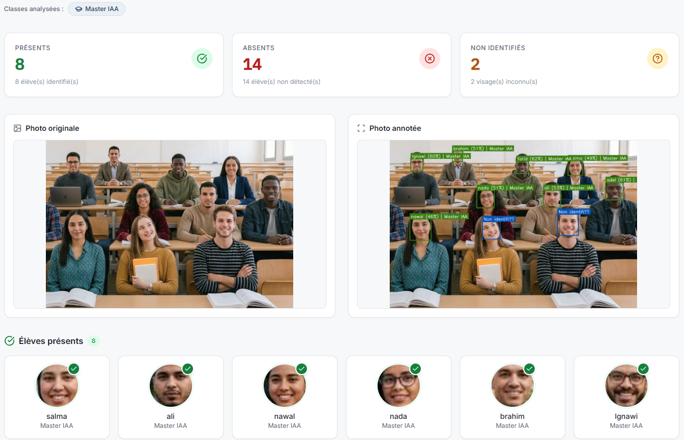

# PrésenceVision – Face Recognition Attendance System


A local Django web app that turns **one class photo** into an **attendance list** (present / absent / unidentified) using face recognition. Everything runs on your machine, on CPU: no student biometric data ever leaves it.

## Features

- **Automatic attendance** from a group photo, with an annotated result image (boxes + names)
- **Per-class comparison**: only the selected classes are checked, which is faster and more accurate
- **Enrollment with manual validation**: detected faces wait in a *pending* list until the teacher assigns a name and class
- **Two roles**: super manager (all users, classes and reports) and teacher (own classes only)
- **Reports** for every session, exportable to **PDF** and **Excel**
- **100 % local**: SQLite database, no cloud service

## How it works

| Step | What happens |
|---|---|
| 1. Detection | HOG locates every face in the photo |
| 2. Encoding | A neural network turns each face into a 128-value vector |
| 3. Comparison | Euclidean distance against the vectors of enrolled students |
| 4. Decision | Distance ≤ 0.6 → present · otherwise → unidentified |

## Tech stack

Django 5.2 · Python 3.11 · `face_recognition` (dlib) · OpenCV · SQLite · Tailwind CSS · ReportLab · openpyxl


## Installation (Windows)

> **Requirements:** Windows and Python **3.11**. The pinned `dlib` wheel in `requirements.txt` is built for Windows / Python 3.11 only.

**1. Get the code and open a terminal in the project folder**

```cmd
git clone https://github.com/ayoub-alla/django-school-face-attendance
cd django-school-face-attendance
```

**2. Install Python 3.11** (skip if already installed)

```cmd
winget install python.python.3.11
```

**3. Create and activate a virtual environment**

```cmd
py -3.11 -m venv .venv
.venv\Scripts\activate.bat
```

**4. Install the dependencies**

```cmd
pip install -r requirements.txt
```

**5. Create the `.env` file with a Django secret key**

Copy the example file:

```cmd
copy .env.example .env
```

Generate a key:

```cmd
python -c "from django.core.management.utils import get_random_secret_key as k; print(k())"
```

Open `.env` and paste the result:

```env
SECRET_KEY=paste_the_generated_key_here
```

> Never commit `.env`: it is already listed in `.gitignore`.

**6. Create the database**

```cmd
python manage.py makemigrations
python manage.py migrate
```

**7. Create your admin account**

```cmd
python manage.py createsuperuser
```

**8. Start the server**

```cmd
python manage.py runserver
```

The app is now available at **http://localhost:8000**.

### Give your account the super manager role

1. Open **http://localhost:8000/admin** and log in with the account from step 7.
2. Go to **Users** and click your account.
3. Tick **Super manager** (and make sure **Superuser status** is checked), then save.

You can now sign in at `http://localhost:8000/login/`, create teachers and classes, and assign classes to teachers.

---

## Test cases

The tests use a fictional class of 22 students (AI-generated faces and names, for demonstration only).



### Case 1 · Well-lit classroom: 9 / 9 identified

All enrolled students are recognized, with match probabilities between **55 % and 62 %**.



### Case 2 · Low light and reduced image quality: 5 / 9 correct

All 9 faces are still detected, but match probabilities drop and 4 students in the back rows are given the wrong name. Good lighting matters.



### Case 3 · Enrolled and unknown students: 8 / 8 identified, 2 / 2 rejected

The two people who are not enrolled are correctly marked **unidentified**. No false positives.



---

## Data model


| Entity | Role |
|---|---|
| `User` | Teacher or super manager (`is_super_manager`) |
| `ClassRoom` | Groups students, belongs to a teacher |
| `Student` | Profile, reference photo and face encoding |
| `PendingFace` | Detected face waiting for manual assignment |
| `AttendanceCheck` | One attendance session |
| `Report` | Downloadable result of a session |

## Project structure

```
├── config/                  # Django settings and root URLs
├── detectorApp/
│   ├── recognition/         # face_engine.py, utils.py (detection, encoding, comparison)
│   ├── reports/             # pdf_export.py, excel_export.py
│   ├── templates/           # HTML pages (Tailwind CSS)
│   ├── models.py  views.py  urls.py
├── manage.py
├── requirements.txt
└── .env.example
```
